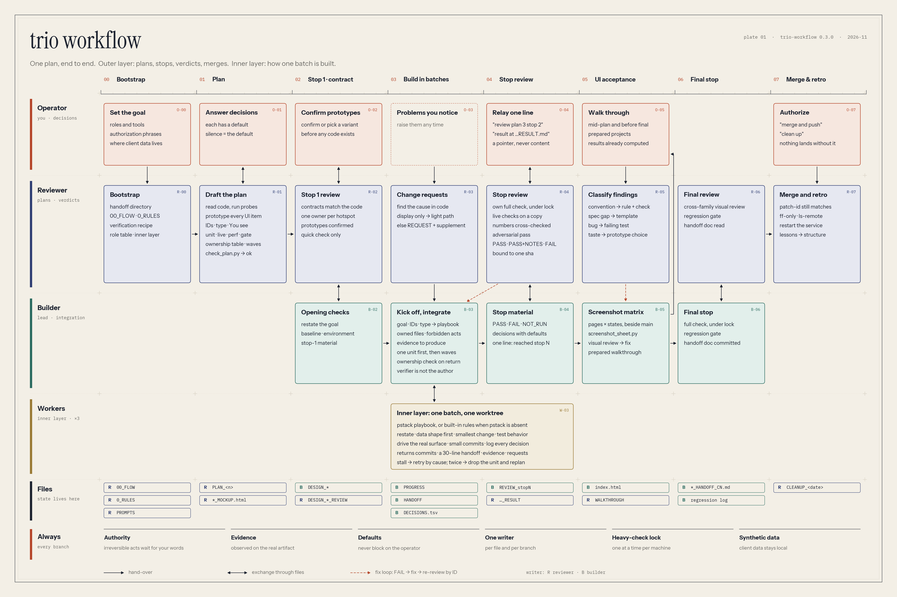

# trio-workflow (repository)

This repository holds the **trio-workflow** plugin, a delivery workflow for coding agents with an operator, a reviewer and a builder. The usage guide is [plugins/trio-workflow/README.md](plugins/trio-workflow/README.md).

## The workflow at a glance



Who acts (lanes) against when (phases), with the files every step writes and the rules every step keeps.

- English: [PNG](docs/workflow/trio-workflow.png) · [PDF](docs/workflow/trio-workflow.pdf)
- 中文: [PNG](docs/workflow/trio-workflow_zh.png) · [PDF](docs/workflow/trio-workflow_zh.pdf)

The plates are drawn by [docs/workflow/draw_workflow.py](docs/workflow/draw_workflow.py), which needs matplotlib. It fails when a caption overflows its cell, so redraw and commit the plates whenever the workflow changes. The visual language is described in [docs/workflow/DESIGN_PHILOSOPHY.md](docs/workflow/DESIGN_PHILOSOPHY.md).

## Layout

| Path | Content |
| --- | --- |
| `plugins/trio-workflow/` | The plugin: the skill, its scripts, and manifests for Claude Code (`.claude-plugin`), Codex (`.codex-plugin`), Cursor (`.cursor-plugin`) and generic agents (`plugin.json`) |
| `.claude-plugin/marketplace.json` | Local Claude Code marketplace `trio-local` |
| `.agents/plugins/marketplace.json` | Local Codex marketplace `trio-local` |
| `tools/install_local.py` | Copy mode: install, check or remove the skill in `~/.claude`, `~/.codex` and `~/.cursor` |
| `tests/` | Behavior tests for the scripts, with sample plans |
| `docs/workflow/` | The workflow plate in English and Chinese (PNG, PDF) and the script that draws it |
| `CHANGELOG.md` | Versions |

## Development

Run the tests:

```bash
python -m unittest discover -s tests
```

Release a new version:

1. Edit the skill under `plugins/trio-workflow/skills/trio-workflow/`.
2. Raise `version` in the four manifests.
3. Add a `CHANGELOG.md` entry.
4. Run the tests.
5. Commit.

If you use copy mode, then run:

```bash
python tools/install_local.py install
```

The repository has no licence yet: it is private and all rights are reserved until a licence is chosen.
